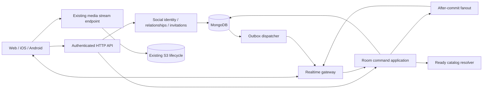

Product behavior remains defined in [business-rules.md](../business-rules.md).

# Social and shared playback architecture (proposed)

The architecture below includes later native, Video and deployment stages.
The current implemented Web Audio slice is defined by the following contract and
[canonical business rules](../business-rules.md#shared-playback-rooms); remaining
proposals must not be read as already delivered capabilities. The active
[implementation plan](../plans/social-and-shared-playback-plan.md) retains the
unverified device and rollout gates.

<!-- @catalog -->
**Contents**

- [Implemented Audio room API](#implemented-audio-room-api)
- [Existing foundation and compatibility](#existing-foundation-and-compatibility)
- [Implemented feasibility boundary](#implemented-feasibility-boundary)
- [Scope and module boundaries](#scope-and-module-boundaries)
- [Identity, relationships, and access](#identity-relationships-and-access)
- [Room permissions and host management](#room-permissions-and-host-management)
- [Persistence and atomic boundaries](#persistence-and-atomic-boundaries)
- [Room protocol and ordering](#room-protocol-and-ordering)
- [Concurrent commands and feedback prevention](#concurrent-commands-and-feedback-prevention)
- [Room snapshots and controller ownership](#room-snapshots-and-controller-ownership)
- [Synchronization and client behavior](#synchronization-and-client-behavior)
- [Media correctness before synchronized playback](#media-correctness-before-synchronized-playback)
- [Disconnection, revocation, and safety](#disconnection-revocation-and-safety)
- [Lifecycle, retention, and operations](#lifecycle-retention-and-operations)
- [External constraints consulted](#external-constraints-consulted)
<!-- @end-catalog -->

## Implemented Audio room API

`src/contracts/roomV1.ts` freezes the runtime wire contract; the earlier
`roomPlaybackPrototype.ts` remains a test feasibility model. Finitude Web's
`/finitude/social` route uses `web/src/api/rooms.ts`, optional discovery reads in
`web/src/api/roomMedia.ts`, `roomSession.ts`, and the
existing player through its lazily loaded room adapter. Native adapters still
use synthetic DEBUG fixtures and do not consume this API yet.

All endpoints are private, require a live revocable session and current Web
account viewer, reject extra query/body fields, and return allowlisted DTOs.
Cookie writes retain the existing same-origin JSON protections. Room HTTP bodies
are capped at 16 KiB; social identity bodies remain capped at 4 KiB.
`X-Finitude-Room-Client` identifies a fresh tab lifetime, not authorization.
Room HTTP has a 180-request/minute window per authenticated account and a total
concurrency ceiling of six/account and 48/process. GET/HEAD work has a smaller
four/account, 40/process ceiling inside that pool, so read bursts alone cannot
occupy every control slot. Commands and tickets still share the original total
ceiling. Identity resolves before the window, as on the social router, so members
behind one NAT keep separate budgets and a new address adds no budget to an
account. Unauthenticated requests, including revoked or expired tokens, spend a
180/minute window per IP before their 401, never an account's window; an
authenticated request over quota still pays the session and user lookups but no
room work. Room and social windows are separate scopes. Rejected admission returns
HTTP 429 with `Retry-After`; occupied slots remain held until both the response
and tracked work complete, including disconnects. These windows and slots are
process memory, which is complete for the single production process; see the
[single-process capacity contract](runtime.md#single-process-capacity-contract).

| Endpoint under `/api/social/v1` | Contract |
| --- | --- |
| `GET /capabilities` | `socialEnabled`, `roomsEnabled`; room admission requires both flags. The public `GET /api/listener/v1/capabilities` reports the same switches as `social: { enabled, rooms }` (both read `src/config/socialRollout.ts`) so signed-out Web pages can hide social entry points |
| `GET /rooms/current`, `GET /rooms/:roomId` | `{ room: snapshot or null }`, always freshly authorized |
| `GET /room-media` | `{ items }`, at most 100 eligible pinned Audio descriptors |
| `GET /room-media/search?q=&cursor=&limit=` | `{ items, nextCursor }`, title substring search; default 20/max 50 eligible pinned Audio descriptors per page |
| `GET /room-media/:mediaTrackId` | `{ item: descriptor or null }`; current active social profile required; missing and ineligible tracks are indistinguishable |
| `GET /room-invitations` | `{ invitations }`, up to 20 current authorized invitations with inviter card, incarnation and expiry; a bounded preview, not an exact total |
| `GET /room-invitations/:invitationId` | `{ invitation: invitation or null }`, original recipient only; unavailable, expired, replaced, revoked and wrong-account links are indistinguishable |
| `GET /rooms/:roomId/invitations` | Current host/controller only; `{ invitations }` containing only `invitationId`, `generation`, `recipientSocialId`, `expiresAtMs` for pending links |
| `GET /rooms/:roomId/community` | Current members only; `{ community }` with room/epoch/revision, up to 20 pending song requests, current-member queue attribution and up to 20 unexpired activity events within 64 KiB |
| `POST /room-commands` | Strict command with original `scopeToken` and `commandId`; status-only social outcome |
| `POST /realtime-tickets` | `{ clientId }`; returns an opaque single-use 30-second ticket |
| WebSocket `/realtime` | Same-origin upgrade, subprotocols `archtree-room-v1` and ticket; only the protocol name is negotiated |

Room media search trims the query, limits it to 100 Unicode characters and
rejects control characters. Title matching treats regex syntax literally.
Descending-ID keyset cursors are signed, account/query bound and expire after
15 minutes. Each page resolves at most 200 candidates; a partial or empty page
may still provide `nextCursor` so older eligible tracks remain reachable. Reads
never analyze or mutate media. The original bounded `/room-media` response stays
available for older Web clients; current pickers use search and pagination.

Tickets never appear in URLs and only their SHA-256 digest is persisted. Issue
and redemption transactionally fence the live account/session. At most five
pending tickets per account are retained. Expiry is checked logically before
any TTL reclamation. The gateway reauthorizes complete state after every committed
invalidation and periodically every five seconds to recover a lost final wakeup.
Outboxes store only invalidation versions, never historical private room payloads.

Invitation list, detail and outgoing projections share current room, host,
profile, friendship and logical-expiry checks. Recipient previews filter before
filling 20 results, with candidate scanning bounded by total room admission
capacity. Detail lookup is independently recipient-scoped, so an older valid
link does not depend on appearing in that preview. Copying a link performs no
mutation: the host reads current outgoing metadata after the original status-only
invite outcome. Reinviting mints a new invitation ID, and old receipts do not
recover a historical URL. Acceptance still uses the original scope/command ID and
the freshly read invitation generation.

The lazy Web global invitation entry shares the room-session singleton with room
pages. It refreshes on a fresh subscription, `socialChanged`, relevant explicit
mutation settlement or outcome recovery, focus and a 15-second fallback.
Ordinary Play, Pause, Seek, Select, Previous and Next settlement rereads the
authoritative room without waking invitation/community queries again; snapshot
revisions still drive the visible community refresh. Local expiry timers handle TTL deletes
that produce no outbox bump. Queries and deferred UI callbacks remain scoped to
the current account epoch, and the existing session privacy barrier hides them
during identity transitions. This is a pending-action indicator, not a durable
notification inbox or read-status model.

The same singleton delivers social changes without the socket. When a five-second
heartbeat finds no connected socket (rooms disabled, still connecting, or lost),
it lazily loads `socialChangeFallback.ts` and ticks it on each later heartbeat
while the socket stays down. In a visible tab the fallback polls `GET /me/changes`
15 seconds after its previous poll. Each unchanged or failed poll doubles that wait
up to 60 seconds, and returning to the tab restores the 15-second wait. A changed
revision runs the same `social` refresh as `socialChanged`: friend requests,
relationship lists, music shares, profile and invitation reads. The first poll
always refreshes, like a fresh subscription. The last seen revision survives
connected periods, so the first poll after a socket loss refreshes only if
something changed. A connected socket stops the polling, and the music-share list
has no fixed poll of its own, so a live socket adds no music-share polling.
Invitations keep their 15-second fallback refetch and capabilities their 30-second
poll while connected.

Community reads preserve the strict room-v1 playback snapshot and WebSocket
schemas. Song requests retain a bounded pending member incarnation and pinned
media identity within the room aggregate. Acceptance revalidates that exact
representation and appends one queue occurrence. Host queue edits carry the
observed epoch, controller, permission, playback and queue versions; stale edits
fail without becoming new commands. Editing another entry preserves the current
timeline and readiness barrier. Community changes advance the existing room
revision/outbox; the visible community query coalesces snapshot-driven refreshes
without reloading unrelated social lists. Explicit community commands also
invalidate only that account's community queries. Invitation-list invalidation
does not also refetch community; snapshot revisions and membership identity
changes still refresh it, and social invalidation still refreshes current cards.
Member removal clears requests and attribution; media invalidation includes
request-only references through the
required `socialRooms.songRequests.mediaTrackId` index.

The `react` member command carries `expectedEpoch` and one token from
`heart`, `clap`, `fire`, `smile`, `music`. It uses ordinary admission and immutable
receipts, independent of controller/playback permissions. Durable account and
room counters enforce 12 and 60 accepted reactions per minute. Internal activity
records retain only an event identity, fixed kind/reaction, membership incarnation
and 30-second expiry. Read projection resolves current social cards, omits departed
actors and trims the oldest events to preserve the existing response byte bound.
Only automatic track advancement uses a null actor. Event append never changes
playback, control or queue generations. Initial/reconnected clients seed existing
event IDs without repeating live announcements; local timers enforce expiry even
when no room revision changes.

Client frames are `ping` with `clientTimeMs` and an optional exact membership /
controller / local-pause heartbeat, or `ready` with an exact readiness report.
Server frames are `subscribed` (protocol, server time, initial room), `snapshot`
(complete current room or null), `pong` and `socialChanged`. Clients never submit
transport commands through WebSocket, and snapshots never generate commands.
Frames are capped at 2 KiB inbound and 64 KiB outbound, reports at 120/minute,
per-connection pending work at eight and output buffering at 128 KiB. The gateway
caps 32 connections per IP and four per account, with 32 pending upgrades. The
process-wide connection cap is deployment capacity (`FINITUDE_REALTIME_MAX_SOCKETS`,
at most 256). The reserved seats number the smaller of (open-room cap × member cap)
and half the cap; each connected room member's first socket takes one, and every
other socket takes one of the remaining general seats, so idle tabs and members'
extra tabs cannot lock admitted members out. One account may hold a quarter of the
general seats (one to four), plus its first socket while in a room. Membership comes
from each socket's latest room read, or a participation lookup at admission only
when it could change the outcome. A seated member socket whose account left every
room is closed with 1013 only while the general seats are over-full. Replacing a
client's own socket needs no seat. Ticket issuance applies the same rule first and
answers `503 realtime_capacity` with `Retry-After: 30`; the upgrade rechecks it and
answers `429`. Finitude Web lets a refused tab create, accept and invite over HTTP
and then connect at once. These are admission bounds; the measured database cost behind the
shipped Elastic Beanstalk values is in the
[capacity screen](../deployment/t4g-micro-capacity-screen.md#social-and-rooms-database-budget--2026-10-04).
Transient snapshot-read contention receives at most three fresh authorized reads
with bounded backoff. It does not retry playback commands or deliver a cached
projection. Revoked access and lost authority close immediately; exhausted
availability repair closes with retryable WebSocket code 1013.
Known-aborted heartbeat/readiness reports use the same bounded retry while keeping
their original occurrence and sequence; uncertain commits are never replayed.
Stale controller reports refresh authorized state. A timer sweep may defer two
consecutive availability failures only after freshly validating the lease; the
third failure closes connections. Each later tick captures its own observation.

Create takes an explicit ordered `mediaTrackIds` selection. Other actions are
`acceptInvitation`, `declineInvitation`, `leave`, `end`, `takeControl`, `invite`,
`kick`, `offerTransfer`, `acceptTransfer`, `cancelTransfer`, `setControlMode`,
`requestSong`, `dismissSongRequest`, `acceptSongRequest`, `removeQueueEntry`,
`reorderQueue`, `react`, `play`, `pause`, `seek`, `next`, `previous` and `select`. Shared transport captures
room epoch, membership/controller generation, control generation, playback
generation, queue revision and current entry. Its immutable identity and observed
versions survive an explicit same-intent retry. A losing command never rebases
itself onto a newer playback occurrence. Host queue edits use the same observed
queue/playback preconditions and preserve the currently playing occurrence.

A complete snapshot includes authority/room/control/queue/playback versions,
version-pinned entries, authoritative timeline, preparation cohort, member cards
and self controller permissions. `serverTimeMs` is an observation; timeline anchors
are absolute server time. Web calibrates its monotonic clock with ping RTT,
preserves the converted anchor on unrelated membership revisions, applies a
350 ms scheduled lead after preparation and performs bounded drift correction.
Actual speaker/output alignment remains a target-environment measurement.

`hostAbsenceDeadlineMs` is non-null while a host absence is recorded and marks
the end of its grace (absence start plus 30 seconds); it remains set after
suspension until the host's controller heartbeats again. The room closes at the
same absence start plus five minutes, so Web derives that deadline from the
contract limits instead of adding a field to the strict room-v1 snapshot.
`transferOffer.expiresAtMs` is visible only to the host and the selected member.
The Web room session records the monotonic `performance.now()` at which it
accepted each snapshot, and a countdown subtracts the time elapsed since that
receipt from the deadline minus the snapshot's own `serverTimeMs`. Snapshots
arrive only when the room changes, so the countdown never starts from the moment
its component mounted: leaving Together and returning, or loading the countdown
chunk late, still shows the time the server has left. Every newer snapshot
re-bases the measurement, and device wall-clock skew cannot shorten or extend the
display. The countdown module loads lazily with the active room; until it loads,
or if it cannot load, the panel shows the countdown-free suspended or ended line.
A countdown at zero issues no command: the sweep owns suspension, closure and
offer expiry.

Preparation lasts at most three seconds. Readiness fences exact room epoch,
member/controller, preparation ID, playback generation, entry and media revision
plus a monotonically increasing report sequence. Preparation completion preserves
that playback generation. Reserved `preparationId: "current"` reports a late or
resynchronizing player's readiness only when no preparation is active and the
exact timeline is playing/paused; it does not restart or move the timeline. The
local player remains silent until its own readiness acknowledgement is visible.
Local pause, disconnect, takeover and revoked controller sessions clear readiness.

`socialRooms` is a bounded aggregate (eight members, 100 entries, 100 active rooms
per deployment). Deployment capacity may lower the open-room and member limits
(`FINITUDE_ROOMS_MAX_OPEN`, `FINITUDE_ROOM_MAX_MEMBERS`); `create` beyond it is
rejected as `room_capacity` and `acceptInvitation` into a full room as `room_full`,
leaving the invitation pending. Sweeps, cleanup and invitation scans keep the
contract maximum as their bound, so lowering a limit never strands an open room. An account-keyed participation row enforces one active room.
MongoDB transactions arbitrate commands, receipts, graph/account fences, source
reference touches, membership, readiness and timers. A deployment-wide 10-second
MongoDB authority lease renews every three seconds; every authority mutation
conditionally writes its live owner/epoch fence using MongoDB time. Takeover
increments the epoch and pauses recovered playback. Safety removal never needs a
leader. This initial deployment requires traffic to reach the lease holder;
per-room routing, distributed fanout and sharding are future capacity work.

Host-only is the default, invites last 24 hours, transfers last 30 seconds,
host grace is 30 seconds and host absence closes after five minutes. A sweep
runs every 250 ms, validates stored session/source state and logically expires
24-hour rooms before releasing participation. Closed rooms have member/queue
identities scrubbed transactionally and expire after 24 hours. Invitation TTL
reclaims expired offers, and room-outbox hints expire after 24 hours. No TTL may
delete an active aggregate before its participation cleanup.

An unchanged sweep uses a complete read-only snapshot of the room, accounts,
controller sessions, current media, and live authority. The same transition
planner performs the subsequent fenced recheck when a change is needed.
An unchanged preparation can use that same complete probe; readiness completion,
deadline handling, cohort removal, and all other required transitions retain the
write path. Missing or uncertain evidence also falls back to it. Before skipping
writes, the sweep rechecks time boundaries and
the authority in a fresh read-only transaction so the original snapshot cannot
hide a committed lease takeover. Actual transitions retain sorted account
fences and the authority write. Natural advancement still uses the original
candidate's playback, queue, entry, and epoch identity across retries.
An injected authority writer without a matching read-only probe retains the
original transaction path.

Media analysis accepts complete PCM16 WAV, mono/stereo 8–48 kHz, with a finite
verified duration no greater than 24 hours. A private representation records
opaque revision, duration, seek eligibility and S3 validators, atomically promoted
with the active object. Public descriptors contain only ID/title/duration/revision
and `/content/mediaTrack/stream/:id?revision=mr_...`. Revision-fenced HEAD/GET pin
ETag/VersionId, recheck the ready representation after storage I/O and reject
stale bytes. Replacing/deleting a source marks old room entries unavailable in
the source transaction. Versionless ordinary streaming retains its contract.

Web room playback does not write Recently Played in this slice. Joining replaces
the executable queue through the existing player; leave/removal detaches the room
and clears the queue without restoring or resuming an earlier queue. Browse playback cannot silently
replace a joined room. Hidden Web Audio tabs continue using fresh authorized
snapshots; visibility alone is not a local pause. Document freeze or pagehide
invalidates the transport incarnation and detaches playback. Resume/pageshow
obtains fresh authorization, while a visibility return also checks both monotonic
and wall-clock pong age against the 15-second freshness bound. Personal resumption
remains explicit. A local Play gesture captures its original command preconditions,
clears the caller's local pause, and waits for the matching heartbeat pong before
sending shared Play, so the HTTP command cannot overtake cohort admission. New
local pause, account/controller/transport changes, or superseded preconditions
cancel that pending gesture; temporary suspension retains uncertain command keys.
Host-control guest Play only resumes personal readiness. Native background operation, downloaded-source preference,
Video capability negotiation, broader audio decoders, queue editing, push
notifications and deployment load evidence remain later stages.

Social and room database transactions allow six total attempts for confirmed
transient aborts or duplicate-key contention. Five waits use 50/100/200/400/600 ms
plus 0–49 ms jitter each (at most 1,595 ms of intentional backoff, excluding
transaction execution). The parsed command and its expected versions stay fixed.
Unknown commit results and post-commit failures are never automatically replayed;
the client retains the original command for explicit outcome checking or retry.

## Existing foundation and compatibility

The repository already supplies Express/Node, transaction-capable MongoDB,
account/session fences, ready-only catalog projections, and identity-bound S3
media delivery. `src/server.ts` attaches the optional authenticated WebSocket gateway using `ws`;
Redis is not required for the initial single-authority implementation.

`src/routes/feedRoutes.ts` restricts publishing to administrators. A Feed Post
author ID is attribution, not a social profile. Playlists are private and
owner-only; avatar bytes are private. The separate Artist Follow plan describes
a private catalog subscription, not a person-to-person relationship. None of
these surfaces becomes social by changing its existing authorization guard.

Audio and Video already share one MediaTrack identity and stream endpoint.
Web uses `web/src/player/playerStore.ts`; iOS uses `AudioManager.swift` with
its shared transport and video projection; Android uses `PlaybackController.kt`
with its app-owned Media3 player. Shared playback adds an orchestration adapter
to those owners. It does not create another media player. Local playback remains
the default mode for clients that do not adopt the new versioned protocol.
The initial review found that Web's transport exposed playback rate as read-only,
iOS lacked scheduled-start/rate control, and Android connected MediaSession
directly to its ExoPlayer and installed an automatically advancing queue. Stage 1
adds isolated feasibility adapters at those seams; this does not enable room
admission or establish production synchronization guarantees. Complete the
three-client evidence and capability fallbacks before freezing the protocol.

## Implemented feasibility boundary

`src/contracts/roomPlaybackPrototype.ts` validates the provisional synthetic
snapshot/command shape. `src/application/rooms/roomPlaybackPrototype.ts` implements
a pure version-fenced transition function and a bounded in-memory authority for
tests. Competing commands consume the same playback generation once; receipts
deduplicate identical intent without returning historical room snapshots. The
prototype models both permission modes and control-generation fencing.

There is no production route, authentication boundary, signed mutation scope,
database transaction, outbox, authority lease or preparation coordinator in this
prototype. In-memory admission demonstrates deterministic arbitration, not
durability or distributed concurrency safety. The later repository must preserve
the original command preconditions across transaction retries.

`contracts/social/prototype-v1/playback-trace.json` is the exact shared synthetic
corpus for backend and three-client tests. Its duplicate, stale, membership-only,
playing and seek frames exercise the existing player through opt-in adapters.
Client adapter types are local normalized inputs, not a released wire protocol.
The active plan records platform checks and remaining physical-device, clock,
media-lifecycle and background-execution gates.

## Scope and module boundaries

Recommended first experience: opt-in social identity, mutually accepted friends,
block controls, account-targeted invitations, and private rooms for 2–8 people.
Ship an Audio room first, then enable Video on the same room protocol after
device evidence. Public discovery, follower counts, user posts, comments, direct
messages, collaborative Playlists, live broadcasts, and voice/video calls are
separate later product decisions. A room does not require a public social feed.

All boxes except clients, MongoDB, and S3 are initially modules in Archtree.
HTTP owns durable commands and snapshot reads; WebSocket pushes current room
snapshots, clock samples, and bounded presence/readiness reports. Both invoke
the same authorization and room application services. v1 has one command ingress,
not competing HTTP and WebSocket mutation implementations. Reconsider WebSocket
commands only if measured HTTP overhead matters; preserve the same command
envelope and application handler. Audio/video bytes never traverse the gateway.

| Module | Responsibility | Boundary |
| --- | --- | --- |
| Social identity | Explicit social alias and discoverability, allowlisted viewer-dependent projection | Never project the raw User model, email, private avatar, saves, or activity |
| Relationships | Requests, accept/remove, bilateral block checks | Person relationships remain separate from private Artist Follow |
| Invitations | Recipient-bound, expiring, revocable room admission | Knowing a room ID or invite ID grants no access |
| Rooms | Membership, host role, queue, authoritative timeline, revision | Room roles grant no catalog/admin rights |
| Realtime | Authorized delivery, reconnect, ephemeral connection state | Socket connection is neither durable membership nor proof of playback |
| Notifications | Durable in-app invitation outcomes and read state | No email/push dependency in v1; recheck access when opening |
| Safety | Block, host removal, invitation throttles, operational abuse handling | Applies to HTTP, subscriptions, replay, notifications, and admission |
| Player adapter | Translate room state into existing transport operations | System controls and queue advancement go through the same mode boundary |

Code seams are `src/contracts/socialV1.ts`, `src/application/social/`,
`src/application/rooms/`, `src/repositories/social/`, and `src/realtime/`.
Social and Audio room contracts, transactional application services, repositories
and the authenticated realtime gateway are implemented. The isolated arbitration
prototype remains a feasibility fixture alongside the production room service.
Transport adapters must not contain independent business rules.

## Identity, relationships, and access

Use a separate opt-in social profile with a new opaque social ID mapped internally
to the existing account. Start with a listener-chosen alias and generated icon.
Do not derive social initials from email or expose the existing private avatar.
Exact social-handle lookup is opt-in, authenticated, bounded, and rate-limited;
it reveals only social ID, handle, alias, and generated icon, even to a non-friend. This
minimal discovery card is distinct from profile access granted by friendship or
active room membership. Pending requests have their own allowlisted alias-card
projection; sending a request cannot unlock additional recipient fields. Do not search registration
identifiers or implement email/contact discovery. Account IDs remain internal;
client member/relationship references use social IDs and membership IDs.

Turning discoverability off prevents new lookup but preserves existing friends.
Deactivating the social profile cancels requests/invitations, removes friendships,
leaves or ends rooms, and revokes social subscriptions before hiding the profile.
Retain owner-private blocks until explicit unblock or account deletion; reactivation
does not restore friends, invitations, or membership. The implemented identity
contract above fixes handles for the account's lifetime and reserves a deleted
handle without its former owner ID for 30 days. Cached handle text can never
substitute for the immutable social ID when accepting an invitation. Room and invitation cleanup now shares the account/social transaction.

Recommended relationship state machine: `none -> pending -> accepted -> none`.
Decline/cancel removes pending access. Crossing requests do not auto-accept;
acceptance must be explicit. One normalized unordered account pair is unique;
each party's directional block state is independent. Unblock restores no prior
request, friendship, invitation, or membership. Blocking atomically cancels
pending requests/invitations, removes friendship, and denies future interaction.

For the small-room v1, any blocked pair is forbidden from co-membership. Reject
admission without revealing which member blocked whom. If members block while
already together, remove the blocked member when the blocker hosts the room;
otherwise remove the blocker, including when the blocked person is host. Apply
the room change in the same serialized operation as the block, and close affected
subscriptions. This is the implemented small-room policy.

An invitation targets one account and one room, expires after a proposed 24 hours,
and is consumed atomically with admission. Accept checks active account, current
friendship with inviter, inviter's invitation permission, blocks against every
member, room state, capacity, and expiry. Replayed acceptance returns the original
result status; any private projection is freshly authorized. Removed membership
is never resurrected by replay. The room host invites in v1. Friendship removal
revokes unused invitations but does not silently end
existing membership; explicit leave, kick, block, or room end does that.
Invitation previews expose only the inviter's consented discovery card, expiry,
and invitation status; membership lists, queue and current media require admission.

The implemented social limits include 500 friends and 50 combined incoming and
outgoing pending requests per account. The implemented room limits are 20
outstanding invitations per host (replacing a friend's still-pending invitation
does not use another), one joined active room per account, eight members per
room, 100 queue entries and 100 open rooms per deployment. Enforce limits
transactionally; revise them only with measured capacity and UX evidence. Apply
both sender and recipient abuse controls so one account cannot flood another
through repeated operations.

## Room permissions and host management

Rooms support `hostOnly` and `everyone`; the proposed creation default is
`hostOnly`. Only the current host can change mode, and the server-confirmed mode
is visible to every participant. The setting applies to shared transport, not
room administration:

| Action | Host control | Everyone control |
| --- | --- | --- |
| Shared Play/Pause/seek/Previous/Next/select existing queue entry | Host's active controller | Every admitted participant's active controller |
| Change mode, invite/kick, add/remove/reorder/share queue items, transfer host, end room | Host only | Host only |
| Volume, mute, explicit Pause on this device, local resync, leave | Each participant for themselves | Each participant for themselves |
| Recommend Audio, withdraw one's own recommendation, send a fixed reaction | Every admitted member, including observers | Every admitted member, including observers |
| Observe playback from a secondary device | Read-only playback | Read-only playback |

Persist `playbackControlMode` and a monotonic `controlGeneration`. A real mode
change or host transfer increments that generation and room revision. Commands
check both the expected control generation and current role/mode in the same
transaction as the playback mutation. Concurrent controls and a mode change
commit in a definite order: a previously committed action remains valid, while
a later stale command is rejected without automatic replay. Toggling back to
Everyone never revives an old command. A same-mode no-op does not bump versions.
All members' seek gestures submit only the final position on release; simultaneous
commands based on one playback generation yield one winner and explicit stale
results, not repeated automatic seeks. Retain per-member and per-room rate bounds.

Changing mode alone preserves the active timeline and an already accepted
preparation. Server completion of that recorded intent remains fenced to its
preparation/playback identity; it is not permission to admit another stale member
command. Pending controls are cleared when permissions change. Shared controls,
system controls and fullscreen controls must show the same effective permission.
Explicit local pause remains a separate action in both modes and requires local
resume/resync before that device participates again.

The proposed host exit UI has two distinct actions:

- **Transfer and leave:** choose a current participant with a live controller;
  that participant explicitly accepts a short-lived offer. Atomically install
  the new host and remove the old host's membership/participation slot. A rejected,
  expired or failed transfer does not silently remove the old host or close the
  room. A remaining lone member may become host; no second guest is required.
- **End room for everyone:** close the room and detach every member. When no
  eligible recipient exists, this is the available host-exit action. A plain
  host-leave API cannot disguise this consequence as a guest leave.

An offer is bound to the current host/control generation, target membership and
controller generations, proposed leave-after-transfer action and server expiry
(initially 30 seconds). Cancel/replace offers explicitly; acceptance rechecks
host authority, target presence/session, blocks, account state and room state.
Removal, rejoin, mode change or controller takeover invalidates a stale offer.
Uncertain acceptance uses its original mutation scope/command ID for outcome
resolution. A competing End room is serialized with acceptance and cannot close
a room after the sender has lost its host role.

Successful transfer preserves playback mode, queue and an already running media
timeline, cancels old-host invitations, and broadcasts the new host. If preparation
is still pending, cancel it under a new playback generation and pause; the new
host explicitly resumes with a fresh readiness round. The previous host never
regains the role merely by reconnecting. There is no automatic host promotion in
v1; absence handling below applies equally to both permission modes.

## Persistence and atomic boundaries

| Proposed collection | Main data and required constraints |
| --- | --- |
| `socialProfiles` | Unique account ID, unique normalized social handle, separate unique social ID, visibility revision |
| `socialRelationships` | Unique canonical pair, request initiator/status, directional blocks, revision; indexes for either participant |
| `socialInvitations` | One unique room-recipient row, invitation generation, inviter, logical expiry/state; reissue advances generation and invalidates prior acceptance |
| `socialRooms` | Host, playback control mode/generation, optional transfer offer, bounded memberships/queue, timeline/preparation, authority epoch, room/queue/playback versions, controller generations, host-absence deadline/suspension, expiry |
| `socialRoomParticipation` | Unique account ID pointing to active room; updated atomically with membership to enforce one-room limit |
| `socialMutations` | Unique actor/mutation-scope/command ID, operation and canonical request digest, result status, retention deadline |
| `socialOutbox` (implemented) | One coalesced account-keyed invalidation revision, with no peer or historical payload |
| `socialRoomOutbox` (proposed) | Explicit room aggregate/epoch/revision/event kind and delivery attempt state; no retained room snapshot; separate from account-keyed social cleanup |
| `socialNotifications` | Unique recipient/event ID, allowlisted invitation reference, read state, expiry |
| `socialRealtimeTickets` | Unique hashed single-use ticket, account/session binding, consumed state, logical expiry |
| `socialAuthority` | One deployment-wide v1 room-writer lease, monotonic fencing epoch, owner nonce and lease deadline |

Keep small room membership and queue state in one bounded aggregate. Do not embed
unbounded relationships, rooms, or notifications into `users`. Create and verify
required unique indexes through the existing additive index catalog before flags
can enable writes. TTL indexes reclaim expired data but never decide access;
every request checks logical expiry itself. One room-recipient invitation row
avoids a time-dependent partial unique index, which the current required-index
verifier would reject. Old invitation generations survive only in bounded receipts.

Commands fence the active account, relevant relationships/catalog references, and
applicable room versions, then commit state + idempotency receipt + outbox record
in one MongoDB transaction. Block/admission races must write the same relationship
and room fences, including initially absent relationship pairs; snapshot reads
alone cannot prevent write skew. Use deterministic fence ordering and bounded
transaction retries. Only committed state is broadcast, outside transaction
callbacks that the driver may retry.
Unknown commit outcomes retain the same key for explicit same-intent retry. Key
reuse with a different body is rejected. Deduplicate before checking a retry's
now-stale expected revision, but recheck current visibility before returning a
stored result. Never replay private payloads to a removed member.

Every durable command also carries an immutable server-issued, authenticated mutation
scope bound to its account and a server-set expiry, initially 24 hours. Its
signature and expiry are checked on every attempt, even after receipts are gone.
The scope plus client-generated command ID identifies intent. Expired scopes
cannot execute; they permit only authorized outcome lookup while a receipt remains.
Clients must not refresh a scope and silently replay an uncertain old intent as
new. Retain receipts through scope expiry; bound issuance, command rates and
outstanding uncertain outcomes. This avoids treating an ancient purged UUID as
a brand-new mutation. Scope tokens are credentials and must not enter logs/URLs.

Immediately after commit, wake in-process fanout for the affected room. Normal
delivery does not wait for a polling interval. The durable outbox is the recovery
path with bounded polling, backoff, claim expiry, and at-least-once processing;
enqueueing a socket message is not proof that its recipient received it.
Coalesce room invalidations to the latest committed snapshot. Recheck current
account/session/membership visibility and project each recipient at send time;
discard queued projections when their access generation changes. Notification
workers also recheck access and deduplicate by recipient/event ID.

An acknowledgement confirms durable commit, not playback by everyone. A crash
between fanout and delivery marking may duplicate delivery; one after commit but
before fanout is recovered from the outbox. Store no historical room/member
payload for replay. MongoDB change streams may later wake the dispatcher but
cannot replace persisted recovery or a current authorized snapshot.

## Room protocol and ordering

Proposed endpoints, all private under `/api/social/v1`:

- `GET/PATCH /me/profile`; exact `GET /profiles?handle=...` lookup.
- `POST /friend-requests`; explicit accept/decline/cancel; idempotent friend
  removal and directional block/unblock resources.
- `POST /rooms`; `GET /rooms/:id`; `POST /rooms/:id/commands` for shared transport
  under the current mode; host-only mode/queue changes, invitations, kick,
  transfer offers and end; target-only offer acceptance; and each member's own
  leave action (with the explicit host-exit semantics above).
- `POST /invitations/:id/accept`; notification list and read-state mutations.
- `POST /mutation-scopes`; account-scoped outcome lookup for uncertain commands.
- `GET /rooms/:id/playback` for a validated, revision-pinned media descriptor.
- `POST /realtime-tickets`; authenticated bootstrap for `/api/social/v1/realtime`.

Freeze exact methods, errors, bounds, and fixtures in Stage 1 before implementation.
Durable domain mutations use the scope/command ID above; bounded authenticated
scope/ticket issuance is bootstrap and does not recursively require a scope.
Room transport commands carry authority epoch, membership/controller generation,
expected control generation, expected playback generation and expected current
queue-entry ID. Relative Previous/Next and queue edits also check the queue
revision whose order the user observed. Server transactions
still CAS the aggregate revision, but a heartbeat or unrelated member join does
not invalidate an authorized participant's Pause intent. Each committed visible state change
advances room revision. Safety actions such as leave/block/session revocation
do not require a fresh displayed room revision. Leave/kick/transfer fence exact
membership incarnation; a delayed kick cannot remove someone who later rejoined.
Transfer requires consent bound to the proposed host's membership generation.
Existing listener-v1 DTOs gain no social discriminators.

## Concurrent commands and feedback prevention

Capture the confirmed current entry and playback/control/queue versions at the
user-action boundary (seek gesture start or button/system-action activation).
Freeze that command envelope through asynchronous dispatch, retries and conflict
handling. A MongoDB transaction retry may refresh internal database reads but
must never substitute newer expected versions or reinterpret Next against a new
entry. The server conditionally commits the transition with its receipt and
outbox notice; the first commit wins for that playback generation.

For a queue A, B, C with A current at playback generation 41:

| Request | Server result |
| --- | --- |
| Participant 1: Next, expected entry A / generation 41 | Commit B in preparation at generation 42 |
| Participant 2: Next, expected entry A / generation 41 | Stale conflict, no playback write; resolve current authorized snapshot |
| Retry participant 1's original scope/command ID | Return its committed outcome status; no new transition |
| Fresh user action after observing B / generation 42 | May advance to C if all current guards still pass |

Both initial requests have distinct command IDs: idempotency alone cannot merge
them. The expected-state condition provides the one-winner behavior. A stale
request receives a controlled conflict such as `409 playback_state_changed`,
clears its pending UI and adopts current state. It never automatically sends a
new Next with updated versions. Queue reordering yields the corresponding stale
queue outcome rather than silently choosing a different successor.

Use two structurally separate client paths:

- `submitUserIntent`: invoked only by an explicit permitted UI/system action;
  creates one immutable command ID and envelope. One action delivered through
  multiple app handlers must still create one intent, not two commands.
- `applyRoomSnapshot`: sets the absolute authoritative entry, source, target
  position and state on the existing player. It never calls the command-submitting
  Next/Play/seek handlers. The originator applies its own server snapshot through
  this same path; ignoring only self-originated messages would not stop peers
  from echoing each other.

Readiness, progress, seeking/seeked, play/pause, buffering, item-change and ended
callbacks are observations. They may update local state or send bounded fenced
readiness/status hints, but never create shared transport commands. Keep source/
playback/application generations on asynchronous callbacks so late effects of an
old snapshot cannot affect a newer one. A short synchronous `isApplyingRemote`
boolean is insufficient because callbacks can arrive after it resets. Where a
native control exposes only an ambiguous state change, report divergence and
require explicit resync rather than infer a new user command from that callback.

Repeated equal/older snapshots are no-ops for transport as well as the UI; a new
membership-only room revision must not reload media or restart playback. Applying
a newer absolute snapshot may perform necessary bounded local correction but
cannot produce a network command. A server end timer and a manual Next compete
on the same playback occurrence; old client ended hints cannot advance the new
entry. At the end boundary the server resolves the current confirmed queue order,
and any transaction retry still preserves the timer's original playback identity.
An optional observed command ID helps resolve pending UI, not authorize replays.

## Room snapshots and controller ownership

Snapshots contain `protocolVersion`, `roomId`, `epoch`, `revision`, `serverTimeMs`,
`playbackControlMode`, `controlGeneration`, current host membership, host-absence
deadline/suspension, allowlisted members/roles and membership generations,
queue revision, ordered
`queueEntryId`/`mediaTrackId` pairs, and a timeline
`{playbackGeneration, entryId, mediaRevision, durationMs, state, positionMs, anchorServerTimeMs, rate}`.
The timeline is null before selection. An active preparation appears in full as
`{preparationId, playbackGeneration, entryId, mediaRevision, targetPositionMs, deadlineServerTimeMs, cohortMembershipIds}`;
it is null after cancellation/scheduling. The recipient-private `self` projection
supplies its membership/controller/access generations and permission/capability
state. A reconnecting client must be able to construct readiness solely from the
current snapshot plus its freshly resolved media descriptor, without an earlier
event. Clients cannot report readiness against a mismatched descriptor generation.
Only the current host and selected target receive the transfer offer's private
action projection; a full snapshot does not expose offer credentials to others.
Queue-entry identity distinguishes repeated playback occurrences. A media
revision is an opaque identity for the exact ready representation, never an S3
key. A distinct social-v1 playback descriptor supplies that revision, validated
numeric duration/seekability, media kind, and a version-pinned public stream URL;
old public listener DTOs and legacy streaming requests keep their contract.

v1 sends one complete room snapshot per state update, with a proposed 64 KiB
encoded cap enforced alongside the eight-member/100-entry bounds. It does not
send fragmented deltas or replay historical snapshots. Queue entries contain
bounded IDs/state; public artwork/titles load separately. Coalesced snapshots
may skip revisions because they are complete. Clients use one reducer for both
HTTP and WebSocket responses, ignoring older/equal revisions within an epoch.
After an acknowledged subscription, buffer bounded snapshots while fetching the
initial HTTP snapshot, then apply only newer states. Server-issued monotonically
increasing authority epochs and a local connection generation prevent old HTTP
responses or sockets from restoring a retired timeline. On a newer epoch, pause
and rebootstrap through the current authorized subscription before applying it.
An unsupported protocol/required capability produces an explicit unavailable
state and detaches room control; repeated snapshot fetches cannot fix it.

Presence/readiness reports use their own sequence and membership/controller/
preparation fences; heartbeats neither advance durable room revision nor write
per-second progress to MongoDB. Profile/alias changes that affect a room snapshot
advance its room revision through a room invalidation transaction. Heartbeat
responses include current durable revision to expose a missed final update. A
polling fallback can read authorized snapshots at a bounded, backoff-controlled
rate while the UI reports reconnecting; it does not advertise synchronized
playback, send readiness, or enable room transport commands. WebSocket recovery
requires a fresh subscription and readiness handshake.

One active controller device per account/room owns local readiness and the shared
commands its account is currently allowed to issue; another device may observe.
Explicit device takeover increments a
generation so the prior device cannot continue controlling. Multiple tabs do
not become additional members. Observers do not play the room stream or report
ready. A server/worker authority lease is separate from the human host role.
Even a one-instance deployment can overlap old/new processes during restart.
v1 therefore has one Mongo-backed deployment-wide room authority lease with a
monotonic epoch allocated only by that authority record; lease expiry uses
MongoDB/server-authoritative time, never a caller-supplied clock. Only its holder
admits realtime participation or commits
transport/preparation/automatic-advance commands. Each such write atomically
fences the live lease and relevant room generation. Loss of renewal stops that
authority; takeover pauses recovered rooms before a new epoch can play.
Non-holders report temporary room unavailability rather than using sticky
sessions as ownership. Deny-only safety cleanup (block/revoke/delete) remains
available, atomically invalidating affected membership/playback generations.
Per-room leases/sharding are a later measured scaling step, not required in v1.

## Synchronization and client behavior

For a playing timeline, compute
`targetMs = clamp(positionMs + max(0, estimatedServerNowMs - anchorServerTimeMs) * rate, 0, durationMs)`.
Before a future anchor, the client waits at `positionMs`; paused state never
advances. Obtain server-clock offset and uncertainty from repeated ping samples,
favor low-RTT samples, and advance the estimate with the client's monotonic clock.
Recalibrate after resume/output-route change, track RTT and offset uncertainty,
and treat an uncertain estimate as unsynchronized. Never trust the host device
clock as room authority. On process restart/clock discontinuity, pause affected
rooms, allocate a new epoch through the singleton authority, and resynchronize instead
of claiming that an uncertain timeline continued exactly.

Permitted Play/select/seek and every entry change, including shared Next and natural
advancement, enter the same persisted preparation round with a unique
`preparationId`, playback generation, exact media revision and target position.
Reports contain those identities plus membership/controller generation and
an increasing report sequence; stale or wrong-source readiness is ignored.
Ready means the source is validated, a seek completed, and the transport can
attempt playback, not merely that a socket exists. Pause/Next/new seek, controller
takeover, media invalidation, and epoch changes cancel prior preparation/timers.

Freeze the readiness cohort to connected, participating controllers at preparation
creation; deliberate local pause excludes any participant, including the host.
Joining/rejoining guests catch up without enlarging that barrier. Removed members
no longer delay it. The host's controller must be present for administration,
but its personal player need not be ready for everyone else to play. Schedule
when the remaining cohort is ready and contains at least one ready participant.
Three seconds is a proposed preparation ceiling, not a fixed delay: at the
deadline, start with ready participants or remain paused if none is ready.
Joining/slow guests do not extend that deadline. A host who pauses only their
device stays host; other permitted controls and natural advancement remain
available, and shared commands never silently resume that device.
Commit the future start anchor before publishing it. Choose its lead from recent
high-percentile RTT, clock uncertainty, and a scheduling margin; 150–750 ms is
an initial tuning range, not a guarantee. If required lead exceeds that bound,
show degraded synchronization instead of claiming readiness. UI feedback can be
immediate while confirmed playback waits for the anchor. A late recipient seeks
to the current authoritative target rather than starting from the old position.
Optional next-entry metadata/media prefetch must fit existing media admission
budgets and reuse the existing player; v1 does not promise gapless transitions.

Initial tuning candidates: ignore drift below 150 ms. Use a brief 0.98–1.02 rate
adjustment only where the transport supports it and the estimated time to reach
tolerance fits a five-second correction deadline; otherwise seek. A 600 ms error
must not be assigned to a 2% correction and then claimed fixed five seconds later.
Restore normal rate on correction completion, pause, entry change, or room exit.
Bound seek retries and add hysteresis; persistent failure stays unsynchronized.
Web measures dispatch-to-progress seek cost only within the existing three-second
observation deadline. A valid measurement above two seconds still permits
correction, while predictive lead remains capped at two seconds. Two measured
follow-ups share one six-second occurrence budget; pause, source replacement,
permission changes, and detachment invalidate pending work.
Unsupported rate correction uses the same bounded seek fallback. Video,
Bluetooth, AirPlay/Cast, background suspension, and device output latency require
separate evidence; matching player positions
does not promise sample-accurate sound from speakers in the same room.

Clients use a `local | room` mode adapter. While in room mode, local natural-end,
queue navigation, Repeat/Shuffle, media-session controls, fullscreen controls,
and transport callbacks cannot independently advance or rewrite the room queue.
The server advances once at the authoritative end boundary; timers and duplicate
client ended reports are fenced to playback generation, exact media revision,
and current authority epoch. Ended reports are hints, not permission to shorten
a track. At the final entry, remain ended; v1 room Repeat/Shuffle are off.
Authorized participants submit shared commands according to the current control
mode. Every participant may mute/adjust volume, explicitly pause on their device
and show unsynchronized state, resync, or leave. A deliberate local pause stays paused until that listener
explicitly resumes/resynchronizes; later room events cannot override it.
If a queued native play event interrupts an owned seek, pausing clears the
pending start flag. Seek or metadata completion may resume only the current
authorized occurrence; local/shared pause, permission loss, source replacement,
and detachment still prevent resumption.
A current start that the browser rejects for a reason other than autoplay policy,
including an interrupted start, does not leave a paused element waiting for the
next timeline. It retries at most twice per playback occurrence, 500 ms after
each rejection, seeking to the live anchor first. The same fences cancel those
retries, and autoplay refusal still waits for explicit resync.
If the native media element reports a download/decoder error or has no usable
metadata, explicit resync reinstalls the exact pinned source in the existing
single player. Overlapping resync gestures share one installation; persistent
failure does not trigger automatic reloads. Retry ownership survives the source
write until current-source metadata/error or a ten-second deadline; that deadline
marks a local failure, exposes resync, and blocks late readiness until a later
explicit gesture. A new local pause remains effective
while bytes load. Completion is fenced to the playback occurrence, attachment,
and physical source generation, and a failed element cannot publish readiness.
A native error also withdraws already-published readiness and pauses this device;
duplicate errors cannot repeat the report. Only current-account, exact-entry and
playback-generation observations may update the session. Explicit recovery waits
for fresh media readiness and server confirmation before playback resumes.
An installation rejection or an already-exposed media error at completion uses
the same failure path without waiting for a native error event.
Native media errors do not expose HTTP status or Retry-After to this adapter;
media admission and a later explicit gesture govern recovery.
Platforms whose native controls cannot be intercepted must detect divergence
and report/resync it rather than imply room authority.

Every playback launch from Home, Search, Album, Library, or Playlist also crosses
this adapter. Ordinary Play while in a room offers explicit Leave and play locally;
host Share selection to room is a separate action. No launch helper may silently
replace the active room queue or accidentally publish a private selection.

Joining explicitly confirms sharing the alias and replacing the active queue
with the room projection. There remains one executable queue/player; any previous
local queue is an inert recovery snapshot. Leaving or removal detaches all room
events and offers an explicit return to local playback without auto-resuming an
old queue. Increment the local player/account generation before detach so late
snapshots cannot replace the new local queue. Observer-device logout disconnects
only that session. Controller-session logout/revocation invalidates its controller
generation and triggers absence handling; it does not let an observer end the
room. Explicit Leave and logout-all/deletion remove account-wide participation
(and end a hosted room unless transfer completed). Clear social caches on every
local account exit. An already-playing public Web stream may continue locally
under the existing logout rule, with no remote control or social disclosure.

Room commands never write another member's Recently Played. Proposed activity
policy: a member's explicit join-and-play or explicit item selection writes that
MediaTrack once only after actual local playback starts; passive commands,
resync, reconnect, and automatic advancement write nothing. Deduplicate against
the local join/play intent and account generation. Promote this exception into
business rules before enabling it.

Room queues copy selected ready MediaTrack IDs into a distinct room aggregate;
they expose no source Playlist ID/name/ownership. Sharing a selection requires
an explicit action. Room queue edits cannot change a private Playlist. v1 uses
online streams even when native Audio downloads exist, avoiding unverified
representation mismatches. This is an explicit proposed exception to the current
business rule that playback always prefers a valid completed local Audio asset;
promote a room-mode exception with native implementation before enabling it.
Ordinary local playback retains its existing download preference.

Advertise supported media kinds per controller generation. A Video queue selection
requires support from every admitted playing controller; an incompatible new
controller remains an observer until an explicit compatible entry/room is chosen.
Revalidate on takeover/reconnect and before automatic advancement. Turning off
Video pauses/ends affected entries explicitly; it never invents an Audio fallback.

## Media correctness before synchronized playback

Current `AudioTrack.duration` and listener-v1 `duration` are display strings,
not authoritative numeric clocks. Extract and validate finite positive
`durationMs` and seekability from the exact stored representation, and bind them
to an opaque server-issued media revision. Backfill legacy media through bounded,
read-only media inspection plus fenced metadata writes; this must not alter bytes,
replace assets, or change ordinary playback visibility. Unknown-duration or
unseekable media remains usable under existing local rules but is ineligible for
v1 rooms. Never trust a member's reported duration to drive automatic advancement.

The social playback descriptor returns a same-origin stream URL carrying an
opaque expected revision (not a credential or object key), suitable for Web,
AVPlayer, and Media3 without custom request headers. On every HEAD/GET/Range,
validate current readiness and exact active revision before opening the object;
reject mismatches without returning replacement bytes. Existing If-Range behavior
may return a full latest body and therefore is not a revision fence. Verify the
new query/response behavior through proxies and every native media loader while
keeping versionless stream semantics intact. Room membership conveys no media
access beyond the existing ready/public catalog contract.

Media replacement/deletion must persist an invalidation notice in its publication
or deletion lifecycle, invalidate preparation, pause the current entry, and mark
removed future entries unavailable. Include room reference cleanup/reconciliation
and missed-notice recovery. Periodic current-source checks provide a bounded
backstop if delivery fails. Clients discard their old room buffer and resolve a
new descriptor before resuming. Requests already admitted may have buffered old
bytes; this design cannot retract downloaded content or promise instantaneous
output revocation. New requests must never silently mix revisions. A live stream
has a different clock/DVR model and is outside on-demand v1 rooms.

## Disconnection, revocation, and safety

Proposed room states: `open -> closing -> closed`; timeline state is separate.
Use an initial ten-second heartbeat interval and mark presence absent after
30 seconds; server liveness deadlines do not depend on a client clock. Membership
is durable until leave/removal/end/expiry. After control-channel loss, label the
client reconnecting immediately and pause shared synchronization after that
grace period, offering explicit local continuation. Rejoin fetches current state
and never replays old transport commands as new intent.

If the host's active controller disconnects, retain its role during a 30-second
grace measured from last verified controller liveness (do not start a second
grace after presence expiry). The grace changes no shared playback: the committed
timeline, an accepted preparation (whose cohort drops the disconnected host
device) and natural advancement continue, and Everyone-control participants keep
Play/seek/select/Previous/Next. The absent host's own disconnected device receives
`host_absent` for those commands until it reconnects, which ends the absence.
Shared Pause remains available to currently authorized controllers. An observer's
socket does not establish host-controller liveness.

At the deadline, the server pauses and persists a host-absent suspension, cancels
any preparation, fences timers, and rejects non-Pause playback commands with
`host_absent` in either control mode, also before a delayed sweep records the
suspension. Everyone control does not bypass that suspension, even after the host
reconnects. A host that returns must authenticate, reclaim its controller through
the normal generation fence, and synchronize; the paused room resumes only through
a subsequent explicit host playback command (Play, Seek, Select, Previous or
Next), because each one starts a new preparation. If host absence reaches five
minutes, close the room even if guests are still connected. No
automatic promotion is performed. A successful explicit transfer before departure
lets the room continue under its new host.

Host logout-all, social deactivation or account deletion closes the room unless
transfer already committed. A single controller-session logout uses absence
handling; an observer-session logout only detaches that session. The host's
intentional room exit uses Transfer and leave or End room for everyone, including
when ordinary browse Play requests local playback. Rooms with no live controller
also close after five minutes and all rooms have a proposed 24-hour maximum life.
Closure/expiry immediately denies access, cancels invitations/preparation, and
releases participation slots through idempotent bounded cleanup. A stale slot
cannot permanently prevent joining another room: admission rechecks its old room
and repairs a terminal reference transactionally. Retained closed-room receipts
never grant access. Recovered expired rooms cannot be reopened by stale clients.

Authenticate Web tickets through existing cookie/current-viewer and origin/CSRF
checks; native clients use current Bearer sessions. Social v1 requires a live,
revocable `authSessions` record: reject sessionless legacy JWTs even if an older
endpoint accepts them. Issue single-use tickets with a proposed 30-second
lifetime, session/viewer/generation binding, and no
tokens in URLs. Browser upgrade admission checks Origin and strict socket limits;
the first frame redeems the ticket within five seconds before any subscription
or data is allowed. Persist hashed ticket redemption state with logical expiry
and atomic one-use consumption. Reauthorize commands, subscriptions, snapshots,
and periodic liveness against account/session/membership
state; close immediately on known revocation and bound missed-revocation exposure
to ten seconds through server-driven revalidation. Auth/database failure expires
the access lease and stops private delivery; it must not extend cached authority.
Client-heartbeat silence cannot suppress the server check. Do not rely only on
token expiry or socket admission.

Use bounded frames, per-account/room command rates, outstanding command limits,
and per-socket send queues. Coalesce presence/timeline hints; disconnect slow
consumers with snapshot recovery when their budget is exceeded. Do not drop
durable state silently. Logs/metrics use bounded outcome categories and latency
buckets, not aliases, room IDs, member IDs, titles, invitation/ticket contents,
or per-user listening history. Render aliases as text and reject unknown fields.

## Lifecycle, retention, and operations

Proposed defaults: notifications expire in 30 days; mutation scopes last 24 hours,
and terminal receipts remain until at least one hour after their scope expiry.
Closed-room payloads expire 24 hours after closure, once membership/reference
cleanup completes; processed outbox invalidations expire after 24 hours. Room
recovery always reads current state, so no historical event replay window exists.
Expired scopes return expiry instead of re-executing even after receipt deletion.
Pending outbox work and uncertain mutations are not blindly TTL-deleted: reconcile
them under bounded retry/backlog budgets, surface unresolved operations, and refuse
new work before backlog exhaustion. Cleanup remains available while admission is
disabled. Notification expiry does not extend invitation or profile visibility.
Presence is ephemeral and is not a listening-history table. Expired invitations
retain only bounded receipt evidence until retry retention ends. Final handle
reuse and abuse-evidence retention policy must be settled before launch.

Account deletion must extend `accountDeletionService.ts` before any social write
is enabled. Preserve existing avatar/provenance preconditions. Serialize social
writers against the same active-account fence; revoke tickets, close hosted
rooms, remove profiles/participation/memberships/relationships/invitations/
notifications/tickets (including references embedded in retained closed rooms),
and scrub identity-bearing receipts/outbox payloads before final user deletion.
If bounded cleanup cannot fit one transaction, persist an explicit deletion
operation and set an account deletion state only after existing preconditions
pass. Current `touchActiveAccount` checks existence, so authentication, private
writers, avatar lifecycle writers and shared-catalog provenance writers must adopt
that deletion-state fence and keep preconditions true throughout asynchronous
cleanup can safely run. Account-owned data is unavailable while deletion proceeds;
return an explicit pending outcome, never success before completion. Reconcile
and resume idempotently after crashes. The canonical behavior change needs promotion
with that implementation. Do not delete shared catalog or private Playlists as
a side effect of leaving/deleting a room. No social S3 assets exist in v1;
future shared avatar/media uploads require their own ownership/visibility and
create/replace/delete/reconciliation contract.

Start with the current deployment and Mongo-backed recovery; introduce neither
Redis nor a dedicated realtime service solely for this design. Media egress grows
roughly as concurrent viewers times bitrate: eight 5 Mbit/s videos are about
40 Mbit/s before overhead, a sizing example rather than measured capacity.
Room presence limits do not prove media capacity. Same-NAT guests also share
existing per-IP stream limits; test this explicitly before enabling eight seats.

Add separate limits for sockets, active rooms, outbox backlog, and room work so
it cannot starve catalog/auth/media. Extend startup/drain to reject upgrades,
notify reconnect, drain committed work, explicitly close upgraded sockets, and
recover rooms after restart. Verify load-balancer/proxy upgrade support and idle
timeouts on the actual deployment. HTTP shutdown behavior alone is insufficient.

Only measured contention justifies extracting realtime workers and introducing
Redis for shared presence/fanout. MongoDB remains authoritative; shared rate
limits, routed room ownership and per-room fencing replace the v1 singleton
before active replicas are introduced. Redis Pub/Sub can lose disconnected-
subscriber messages, so it cannot replace durable state and snapshot recovery.
Separate media CDN/HLS work needs its own readiness, replacement, revocation,
Range, and client contract. Add WebRTC/SFU only for an explicitly requested
microphone/camera capability, with separate permissions and moderation.

The first Web release keeps two rollout flags: `FINITUDE_SOCIAL_ENABLED` for
social admission (profiles, friendships, music shares and listening status) and
`FINITUDE_ROOMS_ENABLED`, which admits rooms only together with social. Shares and
listening status already have per-user opt-in/out and safety exits, and rooms are
Audio-only, so separate share, listening or Audio/Video flags would only multiply
untested combinations that each cost a restart on the single instance. A Video
sync flag arrives with shared Video. A flag change takes effect through a process
restart; an Elastic Beanstalk environment-property update restarts the application.

A process that starts with rooms disabled never installs the gateway. Instead
`src/realtime/roomWindDown.ts` answers every upgrade with an empty `503`, and while
any room is open it holds the room authority to run the ordinary sweep with rooms
disabled every five seconds: shared playback pauses, absent hosts suspend after the
30-second grace and rooms end after five minutes of host absence or at the 24-hour
expiry. Once no room is open it releases the lease and stops polling; a disabled
process cannot open another room. HTTP reads and the safety commands (`leave`,
`end`, `kick`, `declineInvitation`, `cancelTransfer`, `pause`, `dismissSongRequest`)
stay available. Web clients lose the realtime connection, detach room playback and
stop requesting tickets once capabilities report rooms off, so no client applies
invisible room state; HTTP reads return the current paused, suspended or ended
room. Operations are in the [social rollout runbook](../deployment/social-rollout-runbook.md).

## External constraints consulted

- [MDN autoplay guidance](https://developer.mozilla.org/en-US/docs/Web/Media/Guides/Autoplay):
  script-triggered media may require user interaction; admission/readiness must
  represent that state instead of promising automatic playback.
- [MDN WebSocket API](https://developer.mozilla.org/en-US/docs/Web/API/WebSockets_API/index.html):
  the classic WebSocket interface does not provide automatic backpressure;
  application queues and slow-consumer recovery need explicit bounds.
- [Redis Pub/Sub semantics](https://redis.io/docs/latest/develop/interact/pubsub/):
  at-most-once delivery motivates retaining durable state and reconnect recovery.
- [MongoDB change streams](https://www.mongodb.com/docs/manual/changeStreams/):
  resumable delivery has prerequisites; a current snapshot remains the recovery
  path when event history cannot be resumed.
- [MongoDB TTL indexes](https://www.mongodb.com/docs/manual/core/index-ttl/):
  deletion is asynchronous, so ticket/invitation/scope expiry is enforced by reads
  and mutations independently of eventual storage reclamation.
- [MongoDB atomic conditional writes](https://www.mongodb.com/docs/manual/core/write-operations-atomicity/):
  expected current values belong in the update condition; the room's generation
  fence prevents two concurrent commands from consuming the same playback state.
- [Apple scheduled AVPlayer rate](https://developer.apple.com/documentation/avfoundation/avplayer/setrate(_:time:athosttime:)):
  host-time synchronization has player prerequisites; the transport spike must
  validate readiness and buffering configuration instead of assuming parity
  with browser timers.

These sources support transport constraints, not the proposed product defaults
or synchronization targets. No infrastructure or feature was deployed by this
design work.
